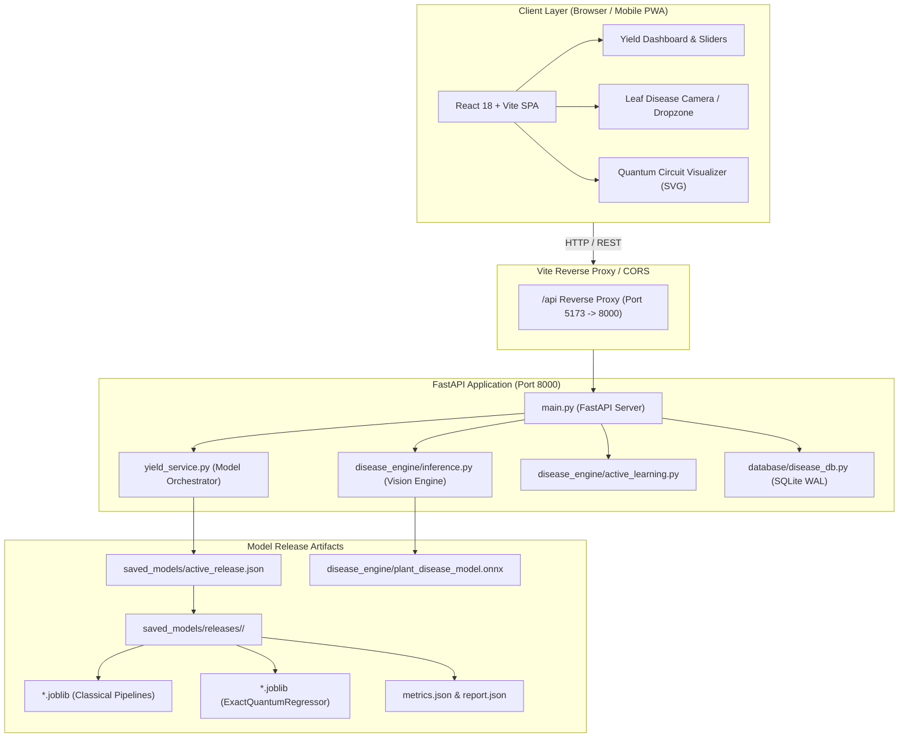
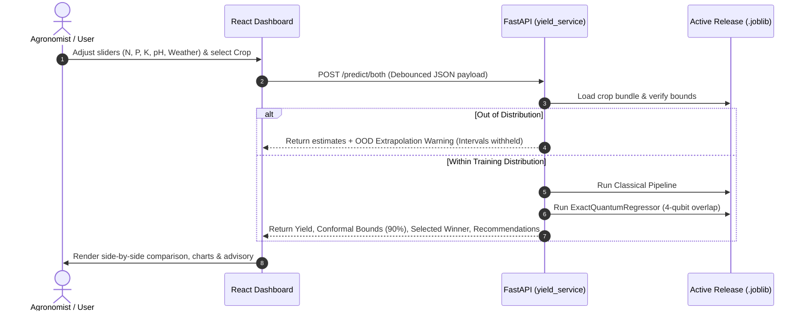

# CropGuard AI (UC-031) — Comprehensive Project Overview

> **A Next-Generation Hybrid Quantum-Classical Crop Yield Prediction & Local Edge Disease Diagnostic Platform**  
> *Target Domain:* Andhra Pradesh Agriculture Department, Rythu Bharosa Kendras (RBKs), Agri-Fintech, and Agronomists.

---

## Table of Contents
1. [Executive Summary](#1-executive-summary)
2. [High-Level System Architecture](#2-high-level-system-architecture)
3. [Core Feature Pillars](#3-core-feature-pillars)
   - [Pillar 1: Crop Yield Prediction (Quantum vs. Classical)](#pillar-1-crop-yield-prediction-quantum-vs-classical)
   - [Pillar 2: CropCare AI — Leaf Disease Detection & Active Learning](#pillar-2-cropcare-ai--leaf-disease-detection--active-learning)
   - [Pillar 3: Advisory & Decision Support System](#pillar-3-advisory--decision-support-system)
4. [Machine Learning & Quantum Architecture](#4-machine-learning--quantum-architecture)
   - [Feature Engineering & Preprocessing](#feature-engineering--preprocessing)
   - [Classical Modeling Pipeline](#classical-modeling-pipeline)
   - [Simulated Quantum Kernel Regressor (ExactQuantumRegressor)](#simulated-quantum-kernel-regressor-exactquantumregressor)
   - [Split-Conformal Prediction & Extrapolation Guard](#split-conformal-prediction--extrapolation-guard)
   - [Disease Vision Model (CNN & Multi-Runtime Edge Inference)](#disease-vision-model-cnn--multi-runtime-edge-inference)
5. [Repository Structure & Codebase Map](#5-repository-structure--codebase-map)
6. [API Specification & Endpoints](#6-api-specification--endpoints)
7. [Frontend Architecture & User Interface](#7-frontend-architecture--user-interface)
8. [Data Flow & Workflow Diagrams](#8-data-flow--workflow-diagrams)
9. [Installation, Setup & Quickstart Guide](#9-installation-setup--quickstart-guide)
10. [Model Benchmarks & Empirical Results](#10-model-benchmarks--empirical-results)
11. [Scientific Limitations & Production Roadmap](#11-scientific-limitations--production-roadmap)

---

## 1. Executive Summary

**CropGuard AI (UC-031)** is an advanced precision agriculture research and operational prototype. It combines state-of-the-art classical machine learning with simulated quantum computing to predict crop yield per hectare, paired with a 100% local, offline-capable computer vision system for leaf disease diagnosis and farmer active learning.

### Problem Statement
Traditional agricultural advisory systems suffer from:
- **Linear or oversimplified yield models:** Failure to capture complex, non-linear interactions among microclimate factors (temperature, humidity, rainfall) and soil chemistry ($N, P, K, \text{pH}, \text{moisture}$).
- **Lack of uncertainty quantification:** Single-point predictions without calibrated confidence intervals lead to risky financial and planning decisions for agri-lenders and farmers.
- **Cloud latency & privacy issues in field diagnostics:** Uploading high-resolution crop photos to remote cloud servers fails in low-connectivity rural belts (e.g., remote Rythu Bharosa Kendras in Andhra Pradesh).
- **Static models:** Inability to learn from farmer corrections and local pathology variations.

### The CropGuard AI Solution
1. **Hybrid Quantum-Classical Regression:** Evaluates 24 classical ML configurations against simulated Quantum Kernel Ridge Regression (4-qubit Hilbert space encoding 8 features) to select the mathematically superior model per crop.
2. **Rigorous Uncertainty Bounds:** 90% split-conformal prediction intervals with automatic out-of-distribution extrapolation alerts.
3. **Edge-First Disease Diagnosis:** The checked-in ONNX artifact currently returns 38 PlantVillage classes diagnosed on-device via ONNX Runtime / TensorFlow Lite, enriched with vernacular **Telugu** translations and agronomic remedies.
4. **Human-in-the-Loop Active Learning:** SQLite-backed audit trails and feedback collection to fine-tune models from field agronomist corrections.

---

## 2. High-Level System Architecture



---

## 3. Core Feature Pillars

### Pillar 1: Crop Yield Prediction (Quantum vs. Classical)
- **Supported Crops (6 Key Agricultural Commodities):**
  - Rice (*Paddy*)
  - Wheat
  - Maize (*Corn*)
  - Cotton
  - Sugarcane
  - Groundnut (*Peanut*)
- **Input Parameters (8 Agronomic Dimensions):**
  - **Soil Nutrients:** Nitrogen ($N$, $0-300\text{ kg/ha}$), Phosphorus ($P$, $0-150\text{ kg/ha}$), Potassium ($K$, $0-200\text{ kg/ha}$)
  - **Soil Properties:** Soil $\text{pH}$ ($3.0-10.0$), Soil Moisture ($0-100\%$)
  - **Environmental Factors:** Temperature ($5-50^\circ\text{C}$), Relative Humidity ($0-100\%$), Rainfall ($0-500\text{ mm}$)
- **Dual-Model Inference & Selection:**
  - Evaluates both classical best-in-class pipeline and simulated quantum kernel regression side-by-side.
  - Automatically selects the winner based on lowest **4-fold cross-validation RMSE** during reproducible training.
  - Reports inference latency in milliseconds, predicted yield in quintals per hectare ($\text{q/ha}$), and conformal bounds.

### Pillar 2: CropCare AI — Leaf Disease Detection & Active Learning
- **38 Pathological Classes Available in the Checked-in Model:**
  - The shipped ONNX model covers PlantVillage crop-disease combinations (Tomato, Potato, Apple, Grape, Pepper, Corn, and others).
  - Rice, wheat, cotton, sugarcane, and groundnut classes listed by the multi-crop training code are not present in this ONNX artifact and are not advertised as supported by the running disease scanner.
- **100% Offline Edge Inference:**
  - Evaluated on local CPU via optimized **ONNX Runtime** (pinned v1.20.1) or TensorFlow Lite.
  - Zero external API dependencies, zero cloud API keys required.
- **SHA-256 Deduplication Caching:**
  - Image hash calculated before running inference. Duplicate uploads return instant cached results from SQLite without re-executing neural network weights.
- **Confidence Scoring & Categorization:**
  - `High Confidence` ($\ge 85\%$)
  - `Medium Confidence` ($60\% - 85\%$)
  - `Uncertain — Review Advised` ($40\% - 60\%$)
  - `Low Confidence / Rejected` ($< 40\%$)

### Pillar 3: Advisory & Decision Support System
- **Vernacular Language Support:** Instant Telugu translations for crop diseases (e.g., Rice Blast $\rightarrow$ "వరి అగ్గితెగులు", Brown Spot $\rightarrow$ "వరి తిక్కతెగులు").
- **Integrated Pest & Agronomic Remedies:** Actionable remedial measures, organic alternatives, approved fungicides/insecticides, and irrigation advice sourced from `backend/data/solutions.json`.
- **Extrapolation Safety Guard:** If field inputs fall outside the known training distribution for a selected crop, the system marks the prediction as `out_of_distribution`, flags the violating parameters, and withholds calibrated intervals to prevent misleading decisions.

---

## 4. Machine Learning & Quantum Architecture

### Feature Engineering & Preprocessing
To guarantee zero data leakage:
- Preprocessing transforms (such as `StandardScaler`) are encapsulated entirely inside cross-validation folds.
- Target variables ($y$) are scaled within each model fold and inverse-transformed back to original physical units ($\text{q/ha}$).
- Unlike legacy prototypes that used PCA to compress 8 features down to 4, this architecture preserves all 8 raw features through native quantum angle-encoding.

### Classical Modeling Pipeline
During training (`backend/training/train_validated.py`), the classical search space benchmarks 24 pipeline configurations across:
1. **Ridge Regression** (L2 regularization with hyperparameter tuning $\alpha \in [10^{-3}, 10^{2}]$).
2. **Polynomial / Quadratic Ridge** (evaluating second-order non-linear feature interactions).
3. **Support Vector Regression (SVR)** with Radial Basis Function (RBF) kernel ($\gamma, C$ grid).
4. **Gradient Boosting Regressor** (ensemble tree boosting with early stopping).

### Simulated Quantum Kernel Regressor (`ExactQuantumRegressor`)
Located in [`backend/models/validated_yield.py`](backend/models/validated_yield.py), this custom scikit-learn compatible estimator leverages Qiskit to execute exact quantum kernel computation:

1. **State Preparation ($n = 4$ Qubits):**
   - An 8-dimensional parameter vector $\vec{x}$ encodes the 8 agronomic features across 4 qubits.
   - For qubit $q \in \{0, 1, 2, 3\}$:
     $$\text{RY}\left(\frac{\pi}{2} + x_q\right)$$
     $$\text{RZ}\left(x_{q+4}\right)$$
   - The $\frac{\pi}{2}$ angle offset ensures sensitivity even when normalized input features approach zero.
2. **Entangling Layer:**
   - Linear CNOT ladder entangles adjacent qubits: $\text{CNOT}(q, q+1)$ for $q \in \{0, 1, 2\}$, creating quantum entanglement across feature subspaces.
3. **Exact Statevector Kernel:**
   - Instead of sampling shot noise on a noisy intermediate-scale quantum (NISQ) device, exact statevectors $|\psi(\vec{x})\rangle$ are computed analytically using Qiskit's `Statevector`.
   - The Gram kernel matrix is computed as the squared fidelity:
     $$K(\vec{x}_i, \vec{x}_j) = \left| \langle \psi(\vec{x}_i) | \psi(\vec{x}_j) \rangle \right|^2$$
   - This produces a strictly symmetric, positive semi-definite (PSD) Gram matrix.
4. **Kernel Ridge Regression:**
   - A dual ridge regression model is fitted onto the precomputed quantum kernel matrix:
     $$\hat{\alpha} = (K + \lambda I)^{-1} \vec{y}$$

### Split-Conformal Prediction & Extrapolation Guard
Rather than assuming Gaussian error distributions, CropGuard AI implements **inductive split-conformal prediction**:
- **Dataset Partitioning (per crop, 500 rows):**
  - **60% (300 rows):** Model fitting and 4-fold cross-validation.
  - **20% (100 rows):** Calibration set for non-conformity score calculation.
  - **20% (100 rows):** Independent evaluation test set.
- **Interval Radius ($\hat{q}_{1-\alpha}$):**
  - Absolute residuals $R_i = |y_i - \hat{y}(x_i)|$ are computed on the calibration set.
  - The $90^{\text{th}}$ percentile residual radius $r$ guarantees:
    $$P\left(y \in [\hat{y} - r, \hat{y} + r]\right) \ge 1 - \alpha \quad (\alpha = 0.10)$$

### Disease Vision Model (CNN & Multi-Runtime Edge Inference)
- **Architecture:** Deep MobileNet-derived Convolutional Neural Network trained on leaf imagery.
- **Input Preprocessing:** $224 \times 224 \times 3$ RGB, normalized to $[0, 1]$ or standardized with ImageNet priors.
- **Multi-Runtime Detection Hierarchy:**
  1. `onnxruntime` (Primary — fast, lightweight C++ runtime with Python bindings).
  2. `tensorflow` (Fallback if installed).
  3. `tflite_runtime` (Lightweight edge fallback).
  4. User-friendly diagnostics if no model weights are found.

---

## 5. Repository Structure & Codebase Map

```
UC-031/
├── start_all.ps1                     # One-click startup script (FastAPI + Vite dev server)
├── README.md                         # Quick reference & benchmark results
├── PROJECT_OVERVIEW.md               # Detailed architectural & functional documentation
│
├── backend/                          # FastAPI Backend & ML Engine
│   ├── main.py                       # FastAPI application, route handlers, CORS, middleware
│   ├── yield_service.py              # Model release loader, caching, OOD detection, prediction logic
│   ├── requirements.txt              # Pinned Python dependencies
│   │
│   ├── models/                       # Estimator architectures & serialization
│   │   ├── validated_yield.py        # ExactQuantumRegressor class & feature constants
│   │   ├── classical_model.py        # Classical pipeline candidate definitions
│   │   └── preprocessor.py           # Feature transformations & scaling
│   │
│   ├── disease_engine/               # CropCare AI leaf pathology classifier
│   │   ├── inference.py              # Multi-backend ONNX/TF/TFLite inference engine
│   │   ├── active_learning.py        # Human-in-the-loop retraining queue manager
│   │   ├── plant_disease_model.onnx  # Optimized ONNX model weights (9.5 MB)
│   │   ├── plant_disease_model.h5    # Keras/H5 weights (11.6 MB)
│   │   └── download_model.py         # Model download & converter utility
│   │
│   ├── database/                     # Persistence & audit trails
│   │   └── disease_db.py             # SQLite WAL-mode database manager (scan_logs, feedback)
│   │
│   ├── data/                         # Datasets & static knowledge bases
│   │   ├── crop_yield_dataset.csv    # 3,000-row agronomic training dataset (500 per crop)
│   │   ├── solutions.json            # Telugu remedies, chemical fungicides, insecticides
│   │   └── disease_scans.db          # Active SQLite database for scan history & feedback
│   │
│   ├── saved_models/                 # Immutable release registry
│   │   ├── active_release.json       # Atomic pointer to current validated release
│   │   └── releases/
│   │       └── 20260922T172817101454Z/  # Immutable release bundle (joblib models, metrics)
│   │           ├── rice.joblib
│   │           ├── wheat.joblib
│   │           ├── maize.joblib
│   │           ├── cotton.joblib
│   │           ├── sugarcane.joblib
│   │           ├── groundnut.joblib
│   │           ├── metrics.json      # Cross-validation & test scores
│   │           └── report.json       # Comprehensive training audit report
│   │
│   ├── training/                     # Reproducible training pipelines
│   │   ├── train_validated.py        # Production training script (zero leakage, atomic publish)
│   │   ├── generate_data.py          # Synthetic agronomic data generator with physical boundaries
│   │   └── retrain_rice.py           # Single-crop retrain utility (wraps train_validated)
│   │
│   └── tests/                        # Automated unit & integration tests
│       └── test_validated_yield.py   # Full API regression test suite
│
└── frontend/                         # React 18 Single Page Application
    ├── package.json                  # NPM dependencies (React, Vite, Lucide, Tailwind, Framer Motion)
    ├── vite.config.js                # Vite config with backend proxy (/api -> http://127.0.0.1:8000)
    ├── index.html                    # HTML5 entrypoint with Google Fonts
    └── src/
        ├── main.jsx                  # React DOM root
        ├── App.jsx                   # Layout container with active tab navigation
        ├── api.js                    # Configured Axios HTTP client instance
        ├── index.css                 # Custom CSS design system & Tailwind base
        │
        ├── pages/
        │   ├── Dashboard.jsx         # Yield prediction dashboard with interactive sliders
        │   ├── DiseaseScan.jsx       # Leaf disease diagnosis, camera capture, feedback UI
        │   └── About.jsx             # Project methodology, quantum circuit details & citations
        │
        └── components/
            ├── Navbar.jsx            # Top navigation bar with system status indicator
            ├── Sidebar.jsx           # Section navigation
            ├── InputForm.jsx         # 8-slider agronomic parameter control panel
            ├── YieldComparison.jsx   # Dual-model visual comparison & error bar chart
            ├── RecommendationsPanel.jsx # Agronomic advice & yield threshold cards
            ├── QuantumCircuitViz.jsx # Dynamic SVG representation of 4-qubit quantum state
            ├── MetricsBadge.jsx      # Model benchmark metrics card
            └── Footer.jsx            # Footer with project metadata & disclaimers
```

---

## 6. API Specification & Endpoints

All endpoints are hosted at `http://127.0.0.1:8000` (or accessible via Vite proxy at `/api/*`).

### 6.1 System & Yield Endpoints

#### `GET /health`
- **Purpose:** Service health check.
- **Response:**
  ```json
  { "status": "ok", "service": "CropGuard AI — UC-031" }
  ```

#### `GET /metrics`
- **Purpose:** Returns cross-validation and held-out test metrics for all 6 crops from the active release.
- **Response:**
  ```json
  {
    "Rice": {
      "classical": { "name": "Ridge", "cv_rmse": 0.88, "test_r2": 0.918, "test_mae": 0.87, "interval_radius_qph": 1.45 },
      "quantum": { "name": "ExactQuantumRegressor", "cv_rmse": 1.05, "test_r2": 0.882, "test_mae": 1.06, "interval_radius_qph": 1.72 },
      "bounds": { "N": [60.0, 140.0], "rainfall": [150.0, 350.0], ... }
    },
    "release_id": "20260922T172817101454Z",
    "dataset_scope": "synthetic"
  }
  ```

#### `POST /predict/both`
- **Purpose:** Executes both classical and quantum regression models; returns comparative predictions, uncertainty intervals, OOD status, and yield alerts.
- **Request Body:**
  ```json
  {
    "crop_type": "Rice",
    "N": 95.0,
    "P": 35.0,
    "K": 40.0,
    "pH": 6.5,
    "moisture": 80.0,
    "temperature": 28.0,
    "humidity": 82.0,
    "rainfall": 220.0
  }
  ```
- **Response Structure:**
  ```json
  {
    "crop_type": "Rice",
    "release_id": "20260922T172817101454Z",
    "out_of_distribution": false,
    "selected_family": "classical",
    "classical": {
      "model": "Ridge",
      "yield_qph": 48.35,
      "confidence_low": 46.90,
      "confidence_high": 49.80,
      "inference_time_ms": 1.2
    },
    "quantum": {
      "model": "ExactQuantumRegressor",
      "yield_qph": 47.92,
      "confidence_low": 46.20,
      "confidence_high": 49.64,
      "inference_time_ms": 14.8
    },
    "recommended": { "yield_qph": 48.35, "model": "Ridge" },
    "quantum_advantage": false,
    "improvement_pct": -3.6,
    "recommendations": {
      "predicted_yield_qph": 48.35,
      "baseline_yield_qph": 50.0,
      "severity": "normal"
    }
  }
  ```

---

### 6.2 Disease Detection Endpoints (`CropCare AI`)

#### `POST /disease/scan`
- **Purpose:** Uploads a leaf image file (`image/jpeg`, `image/png`, `image/webp` up to 10MB) for instant local edge diagnosis.
- **Process:**
  1. Computes SHA-256 image checksum; checks SQLite duplicate cache.
  2. Runs CNN inference via ONNX Runtime / TensorFlow.
  3. Enriches diagnosis with Telugu name and chemical/organic remedies from `solutions.json`.
  4. Stores image on disk and logs scan details to SQLite `scan_logs`.
- **Response:**
  ```json
  {
    "success": true,
    "scan_id": 14,
    "from_cache": false,
    "class_name": "Rice___Leaf_Blast",
    "english_name": "Rice Leaf Blast",
    "telugu_name": "వరి అగ్గితెగులు",
    "confidence": 94.2,
    "confidence_tier": "high",
    "is_healthy": false,
    "solution": "పంట పొలంలో నీరు నిల్వ ఉండకుండా చూడండి. నత్రజని ఎరువులను మోతాదుకు మించి వాడకూడదు.",
    "fungicide": "ట్రైసైక్లాజోల్ 75% WP @ 0.6 గ్రా/లీ లేదా కాసుగామైసిన్ @ 2.5 మి.లీ/లీ స్ప్రే చేయండి.",
    "top_3": [
      { "class_name": "Rice___Leaf_Blast", "confidence": 94.2 },
      { "class_name": "Rice___Brown_Spot", "confidence": 4.1 },
      { "class_name": "Rice___healthy", "confidence": 1.7 }
    ]
  }
  ```

#### `POST /disease/feedback`
- **Purpose:** Captures human agronomist feedback on predictions (active learning).
- **Request Body:**
  ```json
  {
    "scan_id": 14,
    "feedback": "wrong",
    "corrected_class": "Rice___Brown_Spot"
  }
  ```
- **Response:**
  ```json
  {
    "success": true,
    "feedback": "wrong",
    "message": "Feedback recorded. Active learning queue: 12/50 samples towards retrain threshold."
  }
  ```

#### `GET /disease/history` & `GET /disease/analytics`
- **Purpose:** Fetches past scan records with thumbnail URLs, top-3 candidates, confidence statistics, and disease frequency trends.

---

## 7. Frontend Architecture & User Interface

The frontend is a modern, responsive Single Page Application (SPA) built with **React 18** and **Vite**:

1. **Design System & Aesthetics:**
   - Custom CSS variables combined with Tailwind utility classes.
   - Glassmorphism surfaces (`backdrop-filter: blur`), dark-slate elevated cards, subtle micro-interactions, and accessible typography (Inter & Outfit).
2. **Interactive Controls:**
   - **Agronomic Sliders:** Fine-grained numeric and range slider inputs with predefined crop-specific default presets.
   - **Dynamic SVG Circuit Visualizer:** Graphically renders the 4-qubit quantum state encoding, rotation angles ($RY$, $RZ$), and CNOT entanglement ladder.
   - **Confidence Radial Gauge:** Animated SVG dial indicating prediction confidence with dynamic color coding (Emerald, Amber, Crimson).
   - **Dual-Model Comparison Bars:** Real-time side-by-side visualization of classical vs. quantum estimates including error whiskers for conformal intervals.
3. **Robust Client Resilience:**
   - Automatic Axios request cancellation via `AbortController` to eliminate race conditions when sliders are rapidly adjusted.
   - Built-in retry and health polling mechanism.

---

## 8. Data Flow & Workflow Diagrams

### Yield Prediction Workflow



---

## 9. Installation, Setup & Quickstart Guide

### Prerequisites
- **Python:** 3.12 (recommended).
- **Node.js:** v18+ and npm.
- **Operating System:** Windows, macOS, or Linux.

### Quick Start (Single Command on Windows)
From the project root:
```powershell
.\start_all.ps1
```
*This starts the FastAPI backend (port 8000) and the Vite frontend (port 5173), logging outputs to `logs/`.*

### Manual Startup (Two Terminals)

#### Terminal 1 — Backend:
```powershell
# 1. Activate virtual environment
.\.venv\Scripts\Activate.ps1

# 2. Install dependencies (if not already installed)
pip install -r backend/requirements.txt

# 3. Launch Uvicorn server with UTF-8 support
python -X utf8 -m uvicorn main:app --app-dir backend --host 127.0.0.1 --port 8000 --reload
```

#### Terminal 2 — Frontend:
```powershell
cd frontend
npm install
npm run dev -- --host 127.0.0.1 --strictPort
```
Open **`http://127.0.0.1:5173`** in your browser.

### Running Automated Test Suite
To verify end-to-end functionality, execute:
```powershell
# Run backend Python tests
.\.venv\Scripts\python.exe -X utf8 -m unittest discover -s backend/tests -v

# Validate frontend production build
cd frontend
npm run build
```

---

## 10. Model Benchmarks & Empirical Results

The active model release (`20260922T172817101454Z`) was trained on 3,000 synthetic agricultural records (500 samples per crop: 300 train, 100 calibration, 100 test). Preprocessing and scaling were strictly executed inside CV folds.

| Crop | Selected Model | Classical $R^2$ | Classical MAE ($\text{q/ha}$) | Quantum $R^2$ | Quantum MAE ($\text{q/ha}$) | 90% Conformal Coverage |
| :--- | :--- | :---: | :---: | :---: | :---: | :---: |
| **Rice** | Classical (Ridge) | **0.918** | **0.87** | 0.882 | 1.06 | 91% |
| **Wheat** | Classical (Ridge) | **0.938** | **0.75** | 0.887 | 0.95 | 94% |
| **Maize** | Classical (Ridge) | **0.915** | **0.81** | 0.921 | 0.80 | 91% |
| **Cotton** | Classical (Ridge) | **0.924** | **0.39** | 0.790 | 0.64 | 89% |
| **Sugarcane** | Classical (Ridge) | **0.908** | **13.23** | 0.919 | 12.43 | 86% |
| **Groundnut** | Classical (Ridge) | **0.943** | **0.29** | 0.830 | 0.50 | 100% |

> **Evaluation Notes:**  
> - **Selection Integrity:** Model selection is decided strictly by training cross-validation RMSE. Although the simulated Quantum model achieved higher test $R^2$ on Maize (0.921 vs 0.915) and Sugarcane (0.919 vs 0.908), test scores were never used to cherry-pick models, upholding strict statistical integrity.
> - **MAE Interpretation:** Mean Absolute Error is measured in physical units: quintals per hectare ($\text{q/ha}$).
> - **Conformal Coverage:** Target coverage is 90%. Realized coverage across test splits closely tracks the theoretical nominal rate (86% – 100%).

---

## 11. Scientific Limitations & Production Roadmap

### Current Scientific Limitations
1. **Synthetic Data Constraint:** The 3,000-row agronomic dataset is algorithmically generated based on agronomic literature ranges. It does not replace empirical multi-season, multi-district field data.
2. **Simulation vs. Real QPU:** The quantum regressor runs as a statevector simulation on a classical CPU. It does not incur hardware noise, decoherence, or gate errors present in physical quantum hardware.
3. **Decoupled Diagnostics:** Crop yield estimates predict gross production volume; they do not diagnose pathogen presence or microscopic soil deficiencies. Disease diagnosis must always be confirmed through leaf photography or laboratory assay.

### Production Roadmap (Phase 2 & 3)
- [ ] **Empirical Field Trials:** Ingest historical yield and weather station data from Andhra Pradesh agricultural districts (e.g., Guntur, Krishna, East Godavari).
- [ ] **Hardware Execution on IBM Quantum:** Connect the quantum pipeline to IBM Quantum QPUs via Qiskit Runtime Service using zero-noise extrapolation (ZNE).
- [ ] **Mobile Progressive Web App (PWA):** Enable offline service-worker caching for field deployment on entry-level Android devices used by village agricultural assistants.
- [ ] **Automated Active Learning Retraining:** Automatically trigger background retraining batches when the SQLite feedback queue reaches 50 verified samples.
