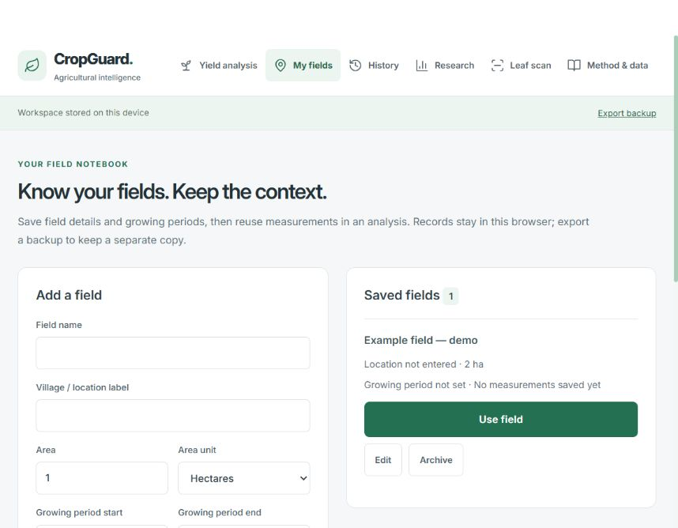

<div align="center">

# CropGuard AI (UC-031)

### Dual-Engine Yield Regression & Edge Plant Pathology Platform

[](https://github.com/purnalokesh31-hub/UC-031)
[](https://github.com/purnalokesh31-hub/UC-031)
[](https://www.python.org/)
[](https://react.dev/)
[](LICENSE)

An agricultural decision engine that couples classical ensemble pipelines and simulated quantum kernel regression for crop yield prediction with finite-sample split-conformal prediction intervals, paired with an ONNX-accelerated plant disease diagnostic classifier.

<br />



</div>

---

## ⚡ Key Capabilities

- ⚛️ **Dual-Engine Yield Modeling**: Evaluates inputs simultaneously through tuned classical estimators (Ridge, SVR, Gradient Boosting) and an 8-feature, 4-qubit simulated quantum kernel ($RY$/$RZ$ feature-map statevector overlaps) without PCA dimensionality bottlenecks.
- 🎯 **Split-Conformal Uncertainty Calibration**: Delivers 90% finite-sample marginal prediction intervals using strictly held-out calibration partitions, complete with real-time distribution boundary checks to prevent unbounded extrapolation.
- 🍃 **Edge-Ready Disease Diagnostics**: Executes sub-50ms plant pathology inference across 38 crop disease classes via an optimized MobileNet architecture running on ONNX Runtime and TFLite runtimes.
- 🌦️ **Automated NASA POWER Telemetry**: Enriches farm field registries with geocoded NASA POWER agrometeorological reanalysis data (surface temperature, precipitation, relative humidity) dating back to 1981.
- 💾 **Local-First Offline Resilience**: Preserves field boundaries, soil scenarios, and historical harvest logs locally in the browser with atomic JSON backup exports and service-worker shell caching.

---

## 🏗️ Architecture

```
┌────────────────────────────────────────────────────────┐
│              React 19 + Vite Dashboard                 │
│    (WorkspaceStore, QuantumWalkthrough, FieldNotebook) │
└───────────┬────────────────────────────────┬───────────┘
            │ HTTP /api                      │ Static PWA
            ▼                                ▼
┌──────────────────────────────┐ ┌───────────────────────┐
│     FastAPI Gateway (8000)   │ │  Service Worker Cache │
├──────────────────────────────┤ └───────────────────────┘
│ • /yield/predict             │
│ • /disease/scan (ONNX)       │
│ • /quantum/walkthrough       │
│ • /workspace/weather (NASA)  │
└──────┬───────────────────────┘
       │
       ├──► Scikit-Learn Pipelines (Ridge, Quadratic, SVR, GBR)
       ├──► Quantum Kernel Simulator (4 Qubits, Statevector Inner Products)
       ├──► MobileNet ONNX Runtime Engine (PlantVillage 38-class)
       └──► Atomic Active-Release Manager (releases/<id>/report.json)
```

---

## 📋 Quick Start

Get the complete dual-stack application running locally in under two minutes.

### Prerequisites

- **Python**: `3.12+`
- **Node.js**: `18.0+` (with `npm`)

### 1. Clone & Setup Backend

```bash
git clone https://github.com/purnalokesh31-hub/UC-031.git
cd UC-031

# Setup virtual environment
python -m venv .venv

# Activate environment (Windows PowerShell)
.\.venv\Scripts\Activate.ps1
# Activate environment (macOS/Linux)
# source .venv/bin/activate

# Install backend dependencies
pip install --upgrade pip
pip install -r backend/requirements.txt
```

### 2. Setup Frontend

```bash
cd frontend
npm install
cd ..
```

### 3. Launch Services

Run both servers concurrently using the provided orchestration script:

```powershell
.\start_all.ps1
```

Or start the backend and frontend services in dedicated shells:

```bash
# Terminal 1: FastAPI Backend
python -X utf8 -m uvicorn main:app --app-dir backend --host 127.0.0.1 --port 8000

# Terminal 2: React Vite Frontend
cd frontend && npm run dev -- --host 127.0.0.1 --port 5173
```

Navigate to `http://127.0.0.1:5173` to access the interactive workspace.

---

## 💻 Programmatic Usage

Query the yield inference engine directly via Python:

```python
import requests

payload = {
    "crop_type": "rice",
    "nitrogen": 80.0,
    "phosphorus": 40.0,
    "potassium": 40.0,
    "ph": 6.5,
    "soil_moisture": 80.0,
    "temperature": 25.0,
    "humidity": 80.0,
    "rainfall": 200.0,
}

response = requests.post("http://127.0.0.1:8000/yield/predict", json=payload)
data = response.json()

print(f"Selected Model: {data['selected_model']}")
print(f"Yield Estimate: {data['predicted_yield']:.2f} quintals/ha")
print(f"90% Interval:   [{data['interval_lower']:.2f}, {data['interval_upper']:.2f}]")
```

---

## ⚙️ Configuration & Environment Variables

Configure application runtime parameters using standard environment variables:

| Variable | Type | Default | Description |
|:---|:---:|:---:|:---|
| `CROPGUARD_HOST` | `string` | `127.0.0.1` | Network interface binding for the FastAPI server |
| `CROPGUARD_PORT` | `integer` | `8000` | Port allocation for incoming HTTP traffic |
| `CROPGUARD_CORS_ORIGINS` | `string` | `http://127.0.0.1:5173` | Comma-separated allowlist for Cross-Origin requests |
| `VITE_API_BASE_URL` | `string` | `/api` | Base path or URL consumed by frontend API services |
| `PYTHONUTF8` | `integer` | `1` | Forces UTF-8 standard encoding streams for Windows shells |

---

## 🔬 Reproducible Model Retraining

Retrain all six crop models across 24 classical and 9 quantum hyperparameter combinations with nested 4-fold cross-validation and conformal calibration:

```bash
python -u backend/training/train_validated.py
```

- **Split Protocol**: 60% Train (4-fold CV) / 20% Conformal Calibration / 20% Held-Out Test.
- **Atomic Deployment**: Writes full pipeline parameters, candidate metrics, and prediction splits into `backend/saved_models/releases/<timestamp>/` and updates `backend/saved_models/active_release.json`.
- **Zero Downtime**: The running API detects the active release pointer modification and reloads weights on the fly.

---

## 🧪 Verification & Testing

Execute the test suites to ensure model determinism, API compliance, and build integrity:

```bash
# Run backend unit, integration, and quantum kernel tests
python -m unittest discover -s backend/tests -v

# Verify frontend production build and asset bundling
cd frontend && npm run build
```

---

## 📄 License

This project is licensed under the [MIT License](LICENSE).
